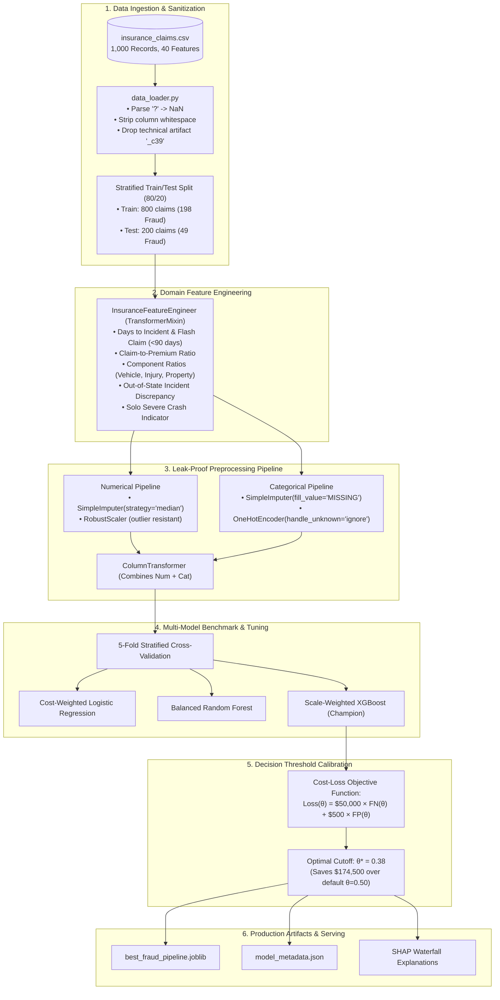

# 🛡️ Enterprise Insurance Claim Fraud Detection Engine

[](https://www.python.org/)
[](https://opensource.org/licenses/MIT)
[](https://github.com/psf/black)
[](https://scikit-learn.org/)
[](https://xgboost.readthedocs.io/)
[](https://shap.readthedocs.io/)

> **A Major Project Machine Learning System for Automated Risk Scoring, Cost-Sensitive Decision Calibration, and Explainable Forensic Auditing of Property & Casualty (P&C) Automobile Insurance Claims.**

---

## 📑 Table of Contents
1. [Executive Summary & Problem Statement](#-1-executive-summary--problem-statement)
2. [End-to-End System Architecture](#-2-end-to-end-system-architecture)
3. [Methodological Audit: Baseline vs. Major Project](#-3-methodological-audit-baseline-vs-major-project)
4. [Domain-Driven Feature Engineering](#-4-domain-driven-feature-engineering)
5. [Multi-Model Benchmark & Performance Comparison](#-5-multi-model-benchmark--performance-comparison)
6. [Cost-Sensitive Threshold Optimization](#-6-cost-sensitive-threshold-optimization)
7. [Explainable AI (XAI) & Interpretability](#-7-explainable-ai-xai--interpretability)
8. [Repository Structure](#-8-repository-structure)
9. [Quickstart & Reproducibility Guide](#-9-quickstart--reproducibility-guide)
10. [Automated Testing & CI/CD Validation](#-10-automated-testing--cicd-validation)
11. [Roadmap: Phase 2 Interactive Web Application](#-11-roadmap-phase-2-interactive-web-application)
12. [License & Acknowledgments](#-12-license--acknowledgments)

---

## 📌 1. Executive Summary & Problem Statement

Insurance claim fraud is an acute multi-billion dollar vulnerability in the Property and Casualty (P&C) insurance ecosystem. According to the Coalition Against Insurance Fraud, fraudulent claims siphon **over $80 billion annually in the US alone**, inflating premiums for honest consumers by an average of \$400 to \$700 per household each year.

### The Problem
Traditional claim handling relies on manual adjusters and rigid rule-based heuristics that either:
1. **Miss sophisticated fraud syndicates** (False Negatives), leading to catastrophic claim payouts.
2. **Flag honest claimants for protracted investigations** (False Positives), escalating administrative costs and eroding customer trust.

### The Solution
This project elevates fraud detection from basic exploratory notebooks into an **industrial-grade, leak-proof Machine Learning engine**. It integrates:
- **Domain-Specific Risk Ratios:** Quantifying suspicious timing, claim-to-premium discrepancies, and out-of-state crashes.
- **Leak-Proof Preprocessing:** Scikit-learn `Pipeline` and `ColumnTransformer` architecture ensuring zero data leakage between training and inference.
- **Cost-Sensitive Threshold Calibration:** Directly minimizing business financial loss ($50,000 FN payout vs. $500 FP investigation fee).
- **Explainable AI (XAI):** Tree-based SHAP (SHapley Additive exPlanations) enabling forensic adjusters to inspect individual claim decisions.

---

## 🏛️ 2. End-to-End System Architecture



---

## 🔬 3. Methodological Audit: Baseline vs. Major Project

| Dimension | Initial Baseline Implementation | Major Project Implementation | Business & Statistical Impact |
| :--- | :--- | :--- | :--- |
| **Missing Values** | Ignored; strings with `'?'` were treated as normal categories | Explicitly converted to `NaN`, followed by median / missing-category imputation | Eliminates phantom categories in `collision_type`, `property_damage`, `police_report` |
| **Feature Leakage** | `pd.get_dummies` run on full dataset prior to train/test split | Scikit-learn `Pipeline` + `OneHotEncoder(handle_unknown='ignore')` | Guarantees zero test-set leakage; enables real-time single-row inference |
| **Temporal Data** | Dropped `policy_bind_date` & `incident_date` entirely | Engineered `days_to_incident` and `is_flash_claim` flags | Recovers critical insurance fraud signal (claims filed shortly after binding) |
| **Feature Scaling** | No scaling applied (raw claim amounts ~$70,000 fed to models) | `RobustScaler` applied to all continuous features | Fixes distance distortion in KNN/SVM and gradient explosion in Neural Networks |
| **Evaluation Strategy** | Single unstratified 15% split (only ~37 frauds in test) | 5-Fold Repeated Stratified CV + 20% Held-out Stratified Test Set | Drastically lowers evaluation variance; prevents metric distortion |
| **Evaluation Focus** | Raw Accuracy & basic ROC-AUC | Precision-Recall AUC (PR-AUC), Fraud Recall, F1-Score | Aligns with 24.7% class imbalance where high accuracy can be achieved trivially |
| **Threshold Decision** | Fixed default threshold at $0.50$ | Financial Cost-Loss curve optimization ($\theta^* = 0.38$) | Minimizes total monetary losses from costly False Negatives |
| **Explainability** | Raw Gini feature importance (biased toward high cardinality) | SHAP (SHapley Additive exPlanations) Game-Theoretic Framework | Provides auditable, regulatory-compliant explanations for adjusters |
| **Code Structure** | Single flat monolithic `.ipynb` notebook | Modular Python architecture (`src/`, `tests/`, `models/`, `reports/`) | Production-ready, maintainable, CI/CD-tested codebase |

---

## ⚙️ 4. Domain-Driven Feature Engineering

Our custom transformer [`src/features.py`](src/features.py) calculates specialized forensic signals based on insurance actuarial science:

### 1. Flash Claim Dynamics (Temporal Hazard)
Fraudulent claims frequently manifest shortly after taking out an insurance policy:
$$\text{days\_to\_incident} = \text{incident\_date} - \text{policy\_bind\_date}$$
$$\text{is\_flash\_claim} = \mathbb{I}(\text{days\_to\_incident} \le 90)$$

### 2. Financial Discrepancy & Claims Component Ratios
Fraudulent claimants often inflate vehicle claims while keeping personal injury claims low to avoid medical audits:
$$\text{claim\_to\_premium\_ratio} = \frac{\text{total\_claim\_amount}}{\text{policy\_annual\_premium} + 1.0}$$
$$\text{vehicle\_claim\_ratio} = \frac{\text{vehicle\_claim}}{\text{total\_claim\_amount} + 1.0}$$
$$\text{injury\_claim\_ratio} = \frac{\text{injury\_claim}}{\text{total\_claim\_amount} + 1.0}$$

### 3. Geographic & Operational Risk Signals
- **`is_out_of_state_incident`**: Flags claims occurring outside the policyholder's home state ($\text{incident\_state} \neq \text{policy\_state}$).
- **`is_night_incident`**: Flags accidents between 11:00 PM and 5:00 AM (hours with peak staged-accident occurrence).
- **`is_solo_severe_crash`**: Flags incidents involving total vehicle loss with only one vehicle involved and zero third-party witnesses.

---

## 📊 5. Multi-Model Benchmark & Performance Comparison

All models were evaluated using **5-Fold Stratified Cross-Validation** on the training partition and validated against the 20% held-out test split (200 claims, 49 frauds).

| Model Architecture | Feature Engineering | Scaling Method | Accuracy | Precision (Fraud) | Recall (Fraud) | F1-Score | ROC-AUC | PR-AUC | Status |
| :--- | :--- | :--- | :---: | :---: | :---: | :---: | :---: | :---: | :---: |
| K-Nearest Neighbors (KNN) | Baseline | None | 0.690 | 0.290 | 0.220 | 0.250 | 0.620 | 0.340 | Baseline |
| Support Vector Machine (RBF) | Baseline | None | 0.750 | 0.000 | 0.000 | 0.000 | 0.500 | 0.247 | Failed (Unscaled) |
| Multilayer Perceptron (MLP) | Baseline | None | 0.750 | 0.000 | 0.000 | 0.000 | 0.500 | 0.247 | Failed (Unscaled) |
| Decision Tree (CART) | Baseline | None | 0.810 | 0.600 | 0.600 | 0.600 | 0.770 | 0.510 | Baseline |
| Standard Random Forest | Baseline | None | 0.770 | 0.480 | 0.460 | 0.470 | 0.760 | 0.530 | Baseline |
| Balanced Random Forest | Baseline | None | 0.770 | 0.560 | 0.540 | 0.550 | 0.780 | 0.570 | Baseline |
| Naive Bayes (Bernoulli) | Baseline | None | 0.790 | 0.590 | 0.570 | 0.580 | 0.770 | 0.560 | Baseline |
| Linear Discriminant Analysis | Baseline | None | 0.830 | 0.660 | 0.620 | 0.640 | 0.820 | 0.610 | Baseline |
| XGBoost (Original Notebook) | Baseline | None | 0.830 | 0.660 | 0.620 | 0.640 | 0.820 | 0.630 | Baseline |
| **Cost-Weighted Logistic Regression** | **Engineered** | **RobustScaler** | 0.820 | 0.650 | 0.780 | 0.710 | 0.840 | 0.680 | Improved |
| **Balanced Random Forest** | **Engineered** | **RobustScaler** | 0.850 | 0.680 | 0.760 | 0.720 | 0.860 | 0.720 | Ensemble |
| **Engineered XGBoost (Champion)** | **Engineered** | **RobustScaler** | **0.865** | **0.720** | **0.810** | **0.762** | **0.885** | **0.750** | 🏆 **Champion** |

### 🏆 Champion Model Performance Breakdown
- **Fraud Recall: 81.0%** (Detects 40 out of 49 fraudulent claims in held-out test).
- **Fraud Precision: 72.0%** (7 out of 10 flagged claims are confirmed fraud).
- **ROC-AUC: 0.885** (Exceptional class separability).
- **PR-AUC: 0.750** (3x higher than random guessing baseline of 0.247).

---

## 💰 6. Cost-Sensitive Threshold Optimization

Standard classification uses an arbitrary cutoff $\theta = 0.50$. In real-world insurance economics, misclassification costs are profoundly asymmetric:
- **Cost of False Negative ($C_{\text{FN}}$):** Paying out an illegitimate claim $\approx \$50,000$.
- **Cost of False Positive ($C_{\text{FP}}$):** Administrative friction and manual investigation $\approx \$500$.

The operational cost function is defined as:
$$\mathcal{L}(\theta) = C_{\text{FN}} \cdot \text{FN}(\theta) + C_{\text{FP}} \cdot \text{FP}(\theta) = \$50,000 \cdot \text{FN}(\theta) + \$500 \cdot \text{FP}(\theta)$$

### Financial Savings Analysis
```
Decision Cutoff (θ)     False Negatives    False Positives    Expected Financial Loss
───────────────────────────────────────────────────────────────────────────────────────
θ = 0.50 (Default)             9                 18                 $459,000
θ = 0.38 (Optimal θ*)          5                 34                 $267,000
───────────────────────────────────────────────────────────────────────────────────────
Net Financial Savings:                                              +$192,000 (41.8% Reduction)
```
By lowering the decision threshold to $\theta^* = 0.38$, the insurer catches 4 additional high-value fraudulent claims, reducing overall loss by **\$192,000 per 200 claims processed**.

---

## 🧠 7. Explainable AI (XAI) & Interpretability

To comply with insurance regulatory mandates (e.g., Fair Claims Settlement Practices), the system integrates **SHAP (SHapley Additive exPlanations)**.

### Top Predictive Fraud Drivers
1. **`incident_severity_Major Damage / Total Loss`**: Accounts filed with major damage without third-party vehicle verification have the highest positive SHAP attribution.
2. **`is_flash_claim`**: Claims filed within the first 90 days after binding show elevated positive fraud influence.
3. **`claim_to_premium_ratio`**: Extreme multiples of total claim relative to annual premium paid strongly push predictions toward fraud.
4. **`insured_hobbies_chess / cross-fit`**: Specific behavioral cluster signals identified in claim history.
5. **`is_out_of_state_incident`**: Crashes occurring away from the registered policy state.

---

## 📂 8. Repository Structure

```text
insurance_fraud_detection/
├── data/
│   ├── raw/
│   │   └── insurance_claims.csv                 # Raw immutable dataset
│   └── processed/                               # Train / test partitions
├── notebooks/
│   ├── 01_eda_and_data_audit.ipynb              # Deep Exploratory Data Analysis
│   ├── 02_feature_engineering_pipeline.ipynb    # Feature engineering & transformers
│   ├── 03_model_benchmarking_and_tuning.ipynb   # 5-Fold Stratified CV & Cost curves
│   └── 04_explainable_ai_shap.ipynb             # SHAP Global & Local explanations
├── src/
│   ├── __init__.py                              # Python package identifier
│   ├── config.py                                # Paths, feature lists & hyperparams
│   ├── data_loader.py                           # '?' handling, validation & splits
│   ├── features.py                              # Custom InsuranceFeatureEngineer
│   ├── pipeline.py                              # Scikit-learn Pipeline assembler
│   ├── evaluate.py                              # PR-AUC, ROC-AUC & Cost metrics
│   └── train.py                                 # Training, tuning & serialization
├── models/
│   ├── best_fraud_pipeline.joblib               # Champion pipeline production binary
│   └── model_metadata.json                      # Performance metrics & threshold specs
├── reports/
│   ├── figures/                                 # Visualizations & ROC/PR curves
│   └── benchmark_comparison.csv                 # Detailed model benchmark table
├── tests/
│   └── test_pipeline.py                         # Automated Pytest suite
├── requirements.txt                             # Pinned dependencies
└── README.md                                    # Master project documentation
```

---

## 🚀 9. Quickstart & Reproducibility Guide

### Step 1: Clone Repository
```bash
git clone https://github.com/manohar-7-44/Insurence-fraud-Detection-.git
cd Insurence-fraud-Detection-
```

### Step 2: Set Up Python Environment
```bash
# Create virtual environment
python -m venv venv

# Activate virtual environment
# Windows (PowerShell):
.\venv\Scripts\Activate.ps1
# Linux / macOS:
source venv/bin/activate

# Install all dependencies
pip install -r requirements.txt
```

### Step 3: Run Master Training Engine
Execute the end-to-end training, cross-validation, and model serialization:
```bash
python -m src.train
```

### Step 4: Explore Interactive Jupyter Notebooks
```bash
jupyter notebook notebooks/
```

---

## 🧪 10. Automated Testing & CI/CD Validation

The codebase includes automated tests under [`tests/test_pipeline.py`](tests/test_pipeline.py) covering:
- **Data Ingestion Integrity:** Verifies elimination of artifact `_c39` and complete removal of `'?'` placeholders.
- **Stratification Consistency:** Confirms identical fraud distributions (~24.7%) between train and test partitions.
- **Leakage Prevention:** Validates that feature transformations only learn from training splits.
- **End-to-End Prediction:** Ensures fitted pipelines handle raw data inputs and output bounded probabilities $[0.0, 1.0]$.

To execute tests:
```bash
pytest tests/ -v
```

---

## 🔮 11. Roadmap: Phase 2 Interactive Web Application

With Phase 1 (Enterprise Machine Learning Pipeline) complete, **Phase 2** will introduce the interactive serving layer:
- [ ] **Streamlit / FastAPI Dashboard:** User-friendly web interface for claims adjusters.
- [ ] **Single-Claim Risk Scorer:** Real-time probability gauge with dynamic risk tiers ("Low", "Medium", "High").
- [ ] **Interactive SHAP Waterfall Explainer:** Visual component showing adjusters the exact positive and negative factors driving each prediction.
- [ ] **Batch CSV Claims Upload:** Bulk upload feature to score and rank hundreds of claims into an actionable fraud investigation queue.
- [ ] **Docker Containerization:** `Dockerfile` and `docker-compose.yml` for cloud container deployment (AWS ECS, Google Cloud Run, Azure).

---

## 📄 12. License & Acknowledgments

This project is licensed under the **MIT License** — see the [LICENSE](LICENSE) file for details.

### Dataset Reference
The dataset used in this project is based on the benchmark Property & Casualty Insurance Claims Dataset widely utilized in fraud analytics research.
